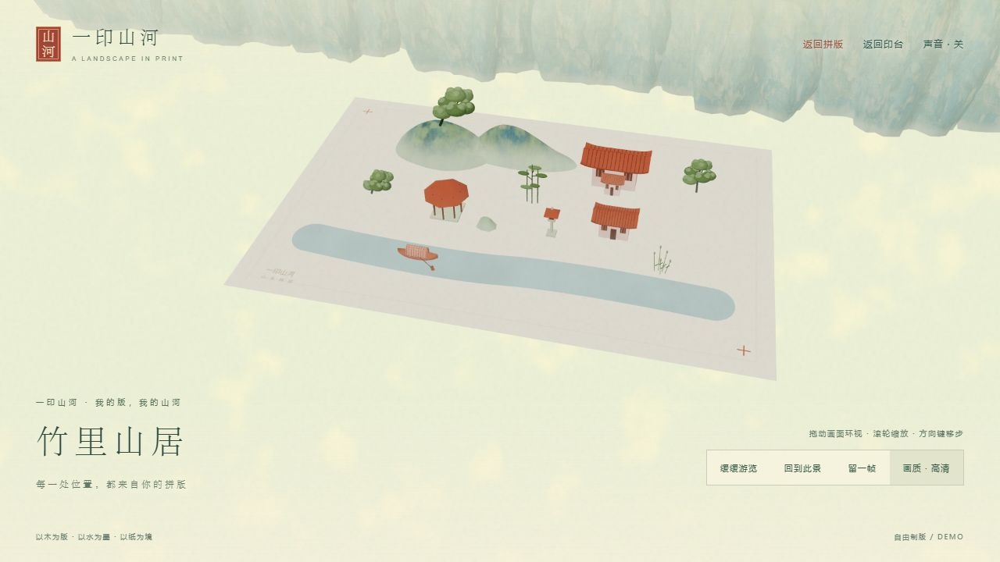

# 一印山河 YinShanHe

木版套印与自由制版交互 Demo。玩家学习套准、上墨、覆纸、刷纸背和揭纸，再自己摆放纹样，印出对应的平面作品与立体山河。

当前可运行版本是 **Three.js 浏览器项目**，包含保留的 0.5 教学版和自由制版。随附的 UE C++ 目录是早期未编译草稿，尚未同步浏览器版本功能，也不是已经完成的 UE 参赛工程。



## 启动试玩

安装 Node.js 18 或以上版本后，在仓库根目录运行：

```sh
npm start
```

没有需要下载的 npm 依赖，无须先运行 npm install。Windows 也可以双击根目录的 start-preview.cmd。启动后访问：

- 自由制版：http://127.0.0.1:8765/creator.html
- 独立试摆：http://127.0.0.1:8765/creator.html?tryout=1
- 教学印坊：http://127.0.0.1:8765/index.html#workshop

服务只监听本机，关闭终端即停止。端口被占用时，可运行 `node work/serve.cjs 8766` 并使用相应端口访问。请使用支持 WebGL 的现代浏览器。

## 当前功能

- 八类、十五种样式：峻峰、远岫、圆丘；溪流；苍松、曲松、修竹；扁舟、篷舟；山居、凉亭、厅堂；湖石、芦苇、石灯。
- 自由放置、拖动、缩放、旋转、原位换样、复制、删除、撤销与重做；山高和河形可以调整。
- 统一三版墨色、反刻木版预览、立体小样及完整套印流程；空白色版自动跳过。
- 新的碰撞或越界调整会回退；船须在水面内，房屋与石灯暂放平地，树根随山面落位。
- 每幅最多24枚纹样；普通入口与独立试摆各保存一份浏览器草稿。刷印进度不跨刷新保存。

先在独立试摆点“竹林小居”，选中素材试试“换一式”，再点“制成木版，去套印”。

## 目录

| 位置 | 内容 |
| --- | --- |
| outputs/YinShanHe | 当前浏览器项目、贴图、第三方库及说明 |
| outputs/YinShanHe-UE | 早期 UE C++ 源码草稿，未编译和运行验证 |
| work/serve.cjs | 本地静态预览服务 |
| work/build-creator-shell.py | 从教学版生成自由制版外壳的维护脚本 |
| work/qa | 自由制版规则、交互和几何检查 |

## 验证

```sh
npm test
```

检查使用 Node.js 内置模块及随附 THREE，不需要额外安装测试框架。程序检查不替代真实浏览器试玩或 GPU 帧率测试。最近一次浏览器验收记录在 [自由制版验证记录](outputs/YinShanHe/自由制版Demo-验证记录.md)。

维护生成文件时，从仓库根目录运行 `python work/build-creator-shell.py`；该脚本会覆盖 creator-studio.js 和 creator.html。常规试玩不需要 Python。

## 项目状态与资料

- [自由制版使用说明](outputs/YinShanHe/自由制版Demo-说明.md)
- [教学版试玩说明](outputs/YinShanHe/试玩说明.md)
- [美术参考与生成材质记录](outputs/YinShanHe/画风参考与制作记录.md)
- [UE 草稿说明](outputs/YinShanHe-UE/README.md)

当前仍是 Demo：尚未提供山上建筑基座、桥路自动连接、自由刻版和多作品管理。参赛类别、引擎及提交要求需按实际报名规则确认。立体山河升起是艺术演绎，不是传统工艺的物理模拟。

Three.js 使用 MIT 许可证，原许可证保存在 [vendor/THREE-LICENSE.txt](outputs/YinShanHe/vendor/THREE-LICENSE.txt)。项目模型、程序图形、合成声音与岩壁设色贴图由本次 AI 协作制作，来源和表达边界见上述说明。仓库尚未为项目自身代码与素材另行指定开放许可。

旧版压缩包、废弃方案和本机完整备份未纳入此源码仓库；用户浏览器中的构图草稿也不包含在仓库中。
